# Modelo relacional: Viveros Tajinaste S.A.

En este documento explicamos cómo hemos pasado el modelo entidad/relación a un modelo relacional, el código con el que hemos creado la base de datos en PostgreSQL y cómo funciona cada restricción.

Archivos:

- [`viveros.sql`](viveros.sql): crea las tablas, los triggers y las vistas.
- [`datos.sql`](datos.sql): inserta datos de prueba.

Para ejecutarlos:

```bash
sudo su postgres
createdb viveros
psql -d viveros
```

```sql
\i viveros.sql
\i datos.sql
```

---

# 1. Modelo entidad/relación de partida

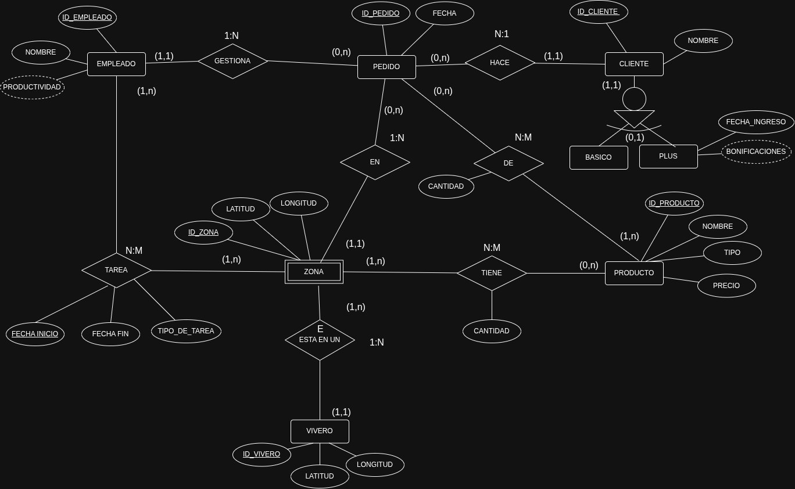

---

# 2. Del modelo entidad/relación al modelo relacional

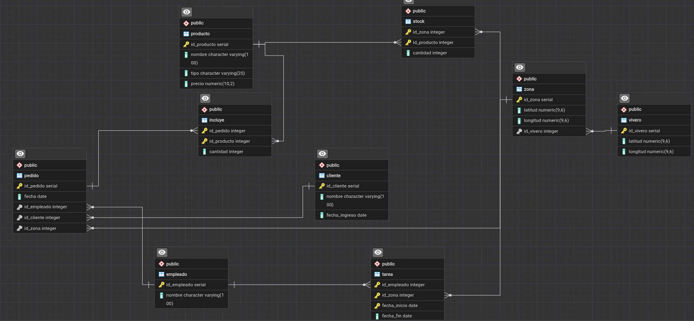


## 2.1 Reglas de transformación

La base de todas las reglas es que **en una tabla cada celda guarda un solo valor**. De ahí sale cómo se transforma cada elemento:

| Elemento del E/R | Cómo se transforma |
|---|---|
| Entidad | Una tabla. El identificador pasa a ser la clave primaria (PK) y los descriptores, columnas. |
| Atributo derivado | No se guarda. Se calcula con una vista. |
| Relación 1:N | No se crea tabla. Se añade una clave foránea (FK) en la tabla de la entidad que participa como máximo una vez: la que está enfrente del (1,1). Si el mínimo es 1, la FK es `NOT NULL`. |
| Relación N:M | Tabla nueva (tabla de unión) con una FK a cada entidad. Su PK es la combinación de las dos FK, y los atributos de la relación son columnas. |
| Entidad débil en existencia | Como una 1:N, con la FK `NOT NULL` y `ON DELETE CASCADE`. |
| Jerarquía | Tres opciones: una tabla por entidad, solo tablas para los subtipos, o una sola tabla con todo. |

**Por qué en una 1:N la FK va en el lado N.** En la relación Gestiona, cada pedido tiene un único empleado, así que la tabla PEDIDO puede guardar ese empleado en una columna `id_empleado`. Al revés no se podría: un empleado gestiona muchos pedidos, y no caben varios valores en una celda.

**Por qué una N:M necesita una tabla nueva.** En la relación Stock, una zona tiene muchos productos y un producto está en muchas zonas. Ninguna de las dos tablas puede guardar a la otra en una columna, así que se crea una tabla intermedia con una fila por cada pareja zona-producto.

## 2.2 Esquema resultante

**PK en negrita**, *FK en cursiva*.

- VIVERO (**id_vivero**, latitud, longitud)
- ZONA (**id_zona**, latitud, longitud, *id_vivero*)
- PRODUCTO (**id_producto**, nombre, tipo, precio)
- EMPLEADO (**id_empleado**, nombre)
- CLIENTE (**id_cliente**, nombre, fecha_ingreso)
- PEDIDO (**id_pedido**, fecha, *id_empleado*, *id_cliente*, *id_zona*)
- STOCK (***id_zona***, ***id_producto***, cantidad)
- INCLUYE (***id_pedido***, ***id_producto***, cantidad)
- TAREA (***id_empleado***, ***id_zona***, **fecha_inicio**, fecha_fin, tipo_de_tarea)

## 2.3 Por qué cada tabla es así

| Tabla | Viene de | Decisión |
|---|---|---|
| VIVERO | Entidad Vivero | Tabla directa. |
| ZONA | Entidad débil Zona + relación Está en (1:N, E) | Recibe la FK `id_vivero`, `NOT NULL` y con `ON DELETE CASCADE`: si se borra un vivero, se borran sus zonas. |
| PRODUCTO | Entidad Producto | Tabla directa. |
| EMPLEADO | Entidad Empleado | Tabla directa. `productividad` es derivado y no se guarda. |
| CLIENTE | Jerarquía Cliente → Básico / Plus | Una sola tabla (ver abajo). `bonificaciones` es derivado y no se guarda. |
| PEDIDO | Entidad Pedido + relaciones Gestiona, Hace y En (1:N) | Recibe las tres FK: `id_empleado`, `id_cliente` e `id_zona`. |
| STOCK | Relación Stock (N:M) | Tabla de unión con el atributo `cantidad` (stock). |
| INCLUYE | Relación Incluye (N:M) | Tabla de unión con el atributo `cantidad` (unidades del pedido). |
| TAREA | Relación Tarea (N:M) | Tabla de unión con `fecha_inicio` en la PK. |

**PEDIDO.** Participa con (1,1) en tres relaciones 1:N: cada pedido tiene un único responsable (Gestiona), un único cliente (Hace) y se sirve desde una única zona (En). Por eso recibe las tres FK, todas `NOT NULL` porque el mínimo es 1. No llevan `ON DELETE CASCADE`: no queremos que borrar un empleado, un cliente o una zona borre sus pedidos y se pierda el histórico de ventas, así que PostgreSQL impedirá borrarlos mientras tengan pedidos.

**CLIENTE (jerarquía).** Cliente tiene los subtipos Básico y Plus, en una jerarquía total y exclusiva. Valoramos hacer una tabla CLIENTE y otra PLUS cuya PK fuera también FK a CLIENTE, pero elegimos **una sola tabla**: Básico no tiene atributos propios y Plus solo tiene uno (las bonificaciones son derivadas), así que una tabla aparte para una sola columna no compensa. La columna `fecha_ingreso` admite `NULL`: si está vacía, el cliente es básico; si tiene fecha, es Plus. Así se cumplen automáticamente la totalidad y la exclusividad, porque un cliente tiene fecha de ingreso o no la tiene. El inconveniente es que el `NULL` adquiere un significado ("no es Plus"); si en el futuro los Plus tuvieran más atributos o relaciones propias, convendría separarlos en otra tabla.

**STOCK y INCLUYE.** Son N:M sin repeticiones: un producto aparece una sola vez en cada zona y una sola vez en cada pedido (si se piden varias unidades, se indica en `cantidad`). Por eso su PK son simplemente las dos FK.

**TAREA.** Es una N:M en la que la misma pareja empleado-zona se puede repetir, porque un empleado puede volver a la misma zona en otra temporada. Por eso la PK incluye también `fecha_inicio`, que ya identificaba cada destino en el E/R. Valoramos usar un identificador propio `id_tarea`, pero por sí solo no impediría registrar dos veces el mismo destino, y añadirle las FK daría una PK con columnas sobrantes que tampoco evitaría duplicados.

---

# 3. Creación de la base de datos

## 3.1 Empezar desde cero

```sql
/* Borrar todo lo que haya en el esquema 'public' para empezar de cero */
DROP SCHEMA public CASCADE;
CREATE SCHEMA public;
```

`DROP SCHEMA public CASCADE` borra el esquema `public` y, por el `CASCADE`, **todo lo que contiene**: tablas, vistas, funciones y triggers. Después se vuelve a crear vacío. Así el script se puede ejecutar varias veces sin errores de "ya existe". Hay que ejecutarlo en una base de datos dedicada a esta práctica, porque borra todo su contenido.

## 3.2 Elementos que usamos al crear las tablas

| Elemento | Qué hace | Ejemplo |
|---|---|---|
| `SERIAL` | Entero que se genera solo (1, 2, 3...). No hace falta indicarlo al insertar. | `ID_VIVERO SERIAL` |
| `PRIMARY KEY` | Clave primaria: no se repite y no puede ser `NULL`. | `ID_VIVERO SERIAL PRIMARY KEY` |
| `PRIMARY KEY (a, b)` | Clave primaria compuesta por varias columnas: lo que no se repite es la combinación. | `PRIMARY KEY (ID_ZONA, ID_PRODUCTO)` |
| `NOT NULL` | Campo obligatorio. | `NOMBRE VARCHAR(100) NOT NULL` |
| `REFERENCES tabla(col)` | Clave foránea: el valor tiene que existir en la otra tabla. | `REFERENCES VIVERO(ID_VIVERO)` |
| `ON DELETE CASCADE` | Si se borra la fila a la que apunta, se borra también esta. Sin él, no se deja borrar la fila referenciada. | En ZONA, STOCK y INCLUYE |
| `DEFAULT valor` | Valor que se usa si no se indica otro. | `DEFAULT CURRENT_DATE` (la fecha de hoy) |
| `CHECK (condición)` | Solo se aceptan filas que cumplan la condición. | `CHECK (PRECIO > 0)` |
| `BETWEEN a AND b` | Entre a y b, ambos incluidos. | `LATITUD BETWEEN -90 AND 90` |
| `IN (...)` | Uno de los valores de la lista. | `TIPO IN ('planta', 'jardineria', 'decoracion')` |

### Tipos de datos

| Tipo | Qué guarda | Por qué lo usamos |
|---|---|---|
| `INT` | Números enteros | Cantidades e identificadores en las FK |
| `NUMERIC(p,s)` | Números decimales exactos: `p` cifras en total, de las cuales `s` son decimales | Precios y coordenadas |
| `VARCHAR(n)` | Texto de como máximo `n` caracteres | Nombres y tipos |
| `DATE` | Fecha (año-mes-día) | Fechas de pedidos, destinos e ingreso |

**`NUMERIC(10,2)`** (precio): 10 cifras, 2 de ellas decimales. Máximo: `99999999.99`. Usamos `NUMERIC` y no `REAL` porque `REAL` redondea, y con dinero los céntimos tienen que ser exactos.

**`NUMERIC(9,6)`** (coordenadas): 9 cifras, 6 decimales, así que quedan 3 para la parte entera. Llega hasta `999.999999`, suficiente para la longitud (-180 a 180); el signo no cuenta como cifra. Seis decimales dan una precisión de unos 10 cm.

**Números naturales.** PostgreSQL no tiene un tipo para naturales, así que se usa `INT` con un `CHECK`: `CHECK (CANTIDAD >= 0)` para el stock, que puede llegar a cero, y `CHECK (CANTIDAD > 0)` para las líneas de pedido, porque no tiene sentido pedir cero unidades.

### CHECK y CONSTRAINT

Una *constraint* (restricción) es cualquier regla que la base de datos obliga a cumplir: `PRIMARY KEY`, `FOREIGN KEY`, `UNIQUE`, `NOT NULL` y `CHECK`. El `CHECK` es el tipo en el que escribimos nosotros la condición.

PostgreSQL pone un nombre automático a cada restricción (por ejemplo, `producto_tipo_check`), que aparece en los mensajes de error y se ve con `\d producto`. La palabra `CONSTRAINT` sirve para darle un nombre propio, y con ese nombre se puede borrar o cambiar más adelante. Por ejemplo, para admitir un tipo de producto nuevo:

```sql
BEGIN;
ALTER TABLE PRODUCTO DROP CONSTRAINT producto_tipo_check;
ALTER TABLE PRODUCTO ADD CONSTRAINT producto_tipo_check
   CHECK (TIPO IN ('planta', 'jardineria', 'decoracion', 'herramientas'));
COMMIT;
```

Va dentro de una transacción para que, si el `ADD` falla, se deshaga también el `DROP` y la tabla no se quede sin restricción. Al añadir un `CHECK`, PostgreSQL comprueba todas las filas que ya existen: si quitamos un tipo que todavía usa algún producto, dará error, y habrá que cambiar antes esos productos con un `UPDATE`.

Usamos `CHECK (TIPO IN (...))` en lugar de dejar el tipo como texto libre para evitar valores como `'planta'`, `'Planta'` y `'plantas'`, que la base de datos trataría como tres tipos distintos.

## 3.3 Tablas

### VIVERO

```sql
CREATE TABLE vivero (
    id_vivero  SERIAL PRIMARY KEY,
    latitud    NUMERIC(9,6) NOT NULL CHECK (latitud BETWEEN -90 AND 90),
    longitud   NUMERIC(9,6) NOT NULL CHECK (longitud BETWEEN -180 AND 180)
);
```

Los `CHECK` limitan las coordenadas a valores reales: la latitud va de -90 a 90 grados y la longitud de -180 a 180.

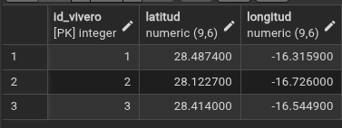

### ZONA

```sql
CREATE TABLE zona (
    id_zona    SERIAL PRIMARY KEY,
    latitud    NUMERIC(9,6) NOT NULL CHECK (latitud BETWEEN -90 AND 90),
    longitud   NUMERIC(9,6) NOT NULL CHECK (longitud BETWEEN -180 AND 180),
    id_vivero  INTEGER NOT NULL REFERENCES vivero(id_vivero) ON DELETE CASCADE
);
```

`ID_VIVERO` es la FK de la relación Está en. Es `NOT NULL` porque toda zona pertenece a un vivero, y `ON DELETE CASCADE` porque Zona es débil en existencia: si se borra un vivero, se borran sus zonas.

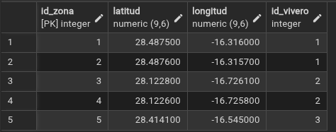

### PRODUCTO

```sql
CREATE TABLE producto (
    id_producto  SERIAL PRIMARY KEY,
    nombre       VARCHAR(100) NOT NULL,
    tipo         VARCHAR(20)  NOT NULL CHECK (tipo IN ('planta', 'jardineria', 'decoracion')),
    precio       NUMERIC(10,2) NOT NULL CHECK (precio > 0)
);

ALTER TABLE producto DROP CONSTRAINT producto_tipo_check;
ALTER TABLE producto ADD CONSTRAINT producto_tipo_check
    CHECK (tipo IN ('planta', 'jardineria', 'decoracion', 'herramientas'));
```

El tipo solo admitía al principio las tres categorías del enunciado. Después añadimos `herramientas`: como el `CHECK` ya existía, hubo que borrarlo (`DROP CONSTRAINT`) y volver a crearlo con la lista nueva (`ADD CONSTRAINT`), usando el nombre automático que PostgreSQL le había dado, `producto_tipo_check`. El precio tiene que ser positivo.

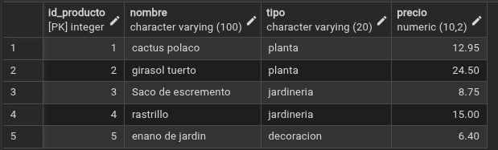

### EMPLEADO

```sql
CREATE TABLE empleado (
    id_empleado  SERIAL PRIMARY KEY,
    nombre       VARCHAR(100) NOT NULL
);
```

La productividad no es una columna: se calcula en la vista `PRODUCTIVIDAD_EMPLEADO`.

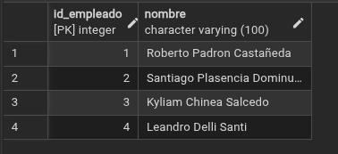

### CLIENTE

```sql
CREATE TABLE cliente (
    id_cliente     SERIAL PRIMARY KEY,
    nombre         VARCHAR(100) NOT NULL,
    fecha_ingreso  DATE
);
```

`FECHA_INGRESO` no es `NOT NULL` a propósito: vacía significa cliente básico; con fecha, cliente Plus. Las bonificaciones no son una columna: se calculan en la vista `BONIFICACIONES_PLUS`.

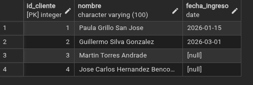

### PEDIDO

```sql
CREATE TABLE pedido (
    id_pedido    SERIAL PRIMARY KEY,
    fecha        DATE NOT NULL DEFAULT CURRENT_DATE,
    id_empleado  INTEGER NOT NULL REFERENCES empleado(id_empleado),
    id_cliente   INTEGER NOT NULL REFERENCES cliente(id_cliente),
    id_zona      INTEGER NOT NULL REFERENCES zona(id_zona)
);
```

Las tres FK vienen de las relaciones Gestiona, Hace y En. Si no se indica la fecha, se usa la de hoy (`DEFAULT CURRENT_DATE`). Como las FK no tienen `ON DELETE CASCADE`, no se puede borrar un empleado, un cliente o una zona que tenga pedidos.

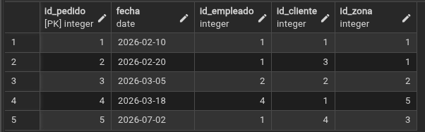

### STOCK

```sql
CREATE TABLE stock (
    id_zona      INTEGER NOT NULL REFERENCES zona(id_zona) ON DELETE CASCADE,
    id_producto  INTEGER NOT NULL REFERENCES producto(id_producto) ON DELETE CASCADE,
    cantidad     INTEGER NOT NULL CHECK (cantidad >= 0),
    PRIMARY KEY (id_zona, id_producto)
);
```

Es el stock: cuántas unidades de cada producto hay en cada zona. La PK compuesta impide que un mismo producto aparezca dos veces en la misma zona. Las dos FK tienen `ON DELETE CASCADE` porque el stock no tiene sentido si desaparece la zona o el producto. La cantidad puede ser 0 (producto agotado), pero no negativa.

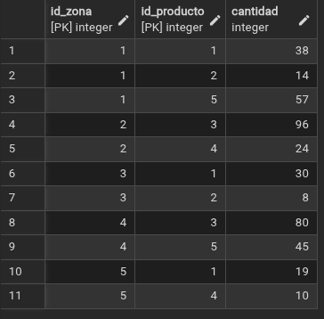

### INCLUYE

```sql
CREATE TABLE incluye (
    id_pedido    INTEGER NOT NULL REFERENCES pedido(id_pedido) ON DELETE CASCADE,
    id_producto  INTEGER NOT NULL REFERENCES producto(id_producto),
    cantidad     INTEGER NOT NULL CHECK (cantidad > 0),
    PRIMARY KEY (id_pedido, id_producto)
);
```

Son las líneas de cada pedido: qué productos lleva y cuántas unidades. Si se borra un pedido, se borran sus líneas (`ON DELETE CASCADE`), pero no se puede borrar un producto que ya se ha vendido, para no perder el histórico.

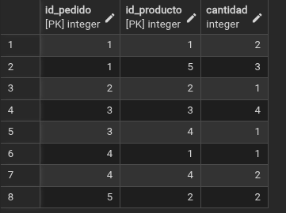

### TAREA

```sql
CREATE TABLE tarea (
    id_empleado    INTEGER NOT NULL REFERENCES empleado(id_empleado),
    id_zona        INTEGER NOT NULL REFERENCES zona(id_zona),
    fecha_inicio   DATE NOT NULL,
    fecha_fin      DATE,
    tipo_de_tarea  VARCHAR(50) NOT NULL,
    PRIMARY KEY (id_empleado, id_zona, fecha_inicio),
    CHECK (fecha_fin IS NULL OR fecha_fin >= fecha_inicio)
);
```

Es el histórico de destinos. `FECHA_FIN` vacía significa que el destino sigue vigente. El `CHECK` impide que un destino termine antes de empezar; el `IS NULL OR` hace falta porque, sin él, una comparación con un valor vacío no da ni verdadero ni falso.

Que un empleado no tenga dos destinos a la vez **no se puede comprobar con un `CHECK`**, porque un `CHECK` solo ve la fila que se está insertando y no puede compararla con las demás. Por eso se hace con un trigger.

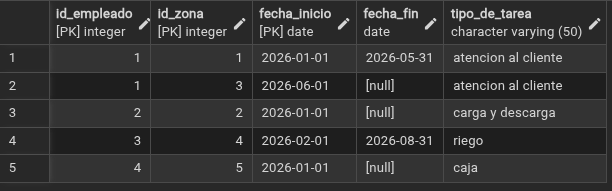

## 3.4 Triggers

### Qué es un trigger

Un trigger es código que se ejecuta automáticamente cuando ocurre algo en una tabla (`INSERT`, `UPDATE` o `DELETE`). Se crea en dos pasos:

1. **Una función**, que dice **qué** hacer.
2. **El trigger**, que dice **cuándo** ejecutar la función.

| Elemento | Qué significa |
|---|---|
| `CREATE OR REPLACE FUNCTION nombre()` | Crea la función, o la sustituye si ya existe. |
| `RETURNS TRIGGER` | Indica que es una función para usar en un trigger. |
| `AS $$ ... $$` | Delimita el código de la función. Puede llevar un nombre entre los dólares (`$ejemplo$`), da igual cuál. |
| `BEGIN ... END;` | Principio y fin del código. |
| `LANGUAGE plpgsql` | El lenguaje de la función: PL/pgSQL, el de PostgreSQL, que permite usar `IF`, variables, etc. |
| `NEW` | La fila que se está insertando o modificando. `NEW.ID_EMPLEADO` es el valor de esa columna en la fila nueva. |
| `OLD` | La fila anterior, en `UPDATE` y `DELETE`. En un `INSERT` no existe. |
| `IF condición THEN ... END IF;` | Ejecuta el código de dentro solo si se cumple la condición. |
| `EXISTS (SELECT ...)` | Verdadero si la consulta devuelve al menos una fila. `NOT EXISTS`, si no devuelve ninguna. |
| `RAISE EXCEPTION 'mensaje'` | Lanza un error: **cancela la operación** y muestra el mensaje. Cada `%` del mensaje se sustituye por los valores que van detrás, en orden. |
| `RETURN NEW;` | Deja que la fila se inserte. |
| `BEFORE` / `AFTER` | Si el trigger se ejecuta antes o después de la operación. |
| `INSERT ON tabla` | Qué operación y sobre qué tabla. |
| `FOR EACH ROW` | Se ejecuta una vez por cada fila afectada. |
| `EXECUTE PROCEDURE función()` | La función que se ejecuta. |

**`BEFORE` o `AFTER`.** Un trigger `AFTER` se ejecuta cuando la fila ya está insertada: sirve para hacer algo como consecuencia, por ejemplo guardar un registro de auditoría. Un trigger `BEFORE` se ejecuta antes, así que puede **impedir** la operación con `RAISE EXCEPTION`. Nuestros dos triggers son de validación, así que son `BEFORE`.

**Cómo funciona `RAISE EXCEPTION`.** Detiene la función y cancela todo el `INSERT`: la fila no se guarda y PostgreSQL muestra el mensaje como error. En un mensaje como `'El empleado % ya tiene un destino', NEW.ID_EMPLEADO`, el `%` se cambia por el número del empleado, y el usuario ve `El empleado 2 ya tiene un destino`. Si hay varios `%`, se sustituyen en orden por los valores que siguen al mensaje.

**Cómo funciona `NEW`.** Dentro de la función, `NEW` es la fila que se intenta insertar, con todas sus columnas. Si alguien ejecuta `INSERT INTO TAREA VALUES (2, 1, '2026-09-01', NULL, 'riego')`, dentro del trigger `NEW.ID_EMPLEADO` vale 2, `NEW.FECHA_INICIO` vale `'2026-09-01'` y `NEW.FECHA_FIN` está vacío. Así la función puede comparar la fila nueva con las que ya hay en la tabla. Al final, `RETURN NEW` devuelve esa fila para que se inserte.

### Trigger: un empleado no puede tener dos destinos a la vez

```sql
CREATE OR REPLACE FUNCTION comprobar_destinos() RETURNS TRIGGER AS $$
   BEGIN
      IF EXISTS (
         SELECT * FROM TAREA
         WHERE ID_EMPLEADO = NEW.ID_EMPLEADO
           AND (FECHA_FIN IS NULL OR FECHA_FIN >= NEW.FECHA_INICIO)
           AND (NEW.FECHA_FIN IS NULL OR NEW.FECHA_FIN >= FECHA_INICIO)
      ) THEN
         RAISE EXCEPTION 'El empleado % ya tiene un destino en esas fechas', NEW.ID_EMPLEADO;
      END IF;
      RETURN NEW;
   END;
$$ LANGUAGE plpgsql;

CREATE TRIGGER trg_comprobar_destinos BEFORE INSERT ON TAREA
FOR EACH ROW EXECUTE PROCEDURE comprobar_destinos();
```

**Qué calcula.** Antes de insertar un destino, busca en TAREA si el **mismo empleado** (`ID_EMPLEADO = NEW.ID_EMPLEADO`) ya tiene un destino cuyas fechas se crucen con las del nuevo.

**Cómo se detecta el solapamiento.** Dos periodos se solapan si **cada uno empieza antes de que termine el otro**:

- `FECHA_FIN >= NEW.FECHA_INICIO`: el destino que ya existe termina después de que empiece el nuevo.
- `NEW.FECHA_FIN >= FECHA_INICIO`: el destino nuevo termina después de que empiece el que ya existe.

Si se cumplen las dos, se pisan. Ejemplo con un destino existente de junio a septiembre:

| Destino nuevo | ¿Existente acaba después de que empiece el nuevo? | ¿Nuevo acaba después de que empiece el existente? | Resultado |
|---|---|---|---|
| Julio – agosto | Sí | Sí | Se solapan: error |
| Octubre – diciembre | No (acaba en septiembre) | Sí | No se solapan: se inserta |
| Enero – marzo | Sí | No (acaba antes de junio) | No se solapan: se inserta |

**Los destinos sin fecha de fin.** Un destino con `FECHA_FIN` vacía sigue abierto, así que no termina nunca. Por eso cada condición lleva delante `FECHA_FIN IS NULL OR`: si el destino no tiene fin, se considera que termina después de cualquier fecha. Así tampoco se puede empezar un destino nuevo sin cerrar antes el anterior.

**Qué hace al final.** Si encuentra un destino que se cruza (`IF EXISTS`), cancela la inserción con `RAISE EXCEPTION`. Si no, `RETURN NEW` deja que se inserte.

Prueba: intentar dar al empleado 2, que tiene un destino abierto desde enero, otro destino en septiembre.

```sql
INSERT INTO TAREA VALUES (2, 1, '2026-09-01', NULL, 'riego');
```

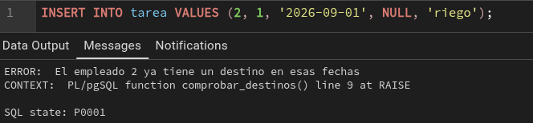

### Trigger: un pedido no puede incluir más unidades de las disponibles

```sql
CREATE OR REPLACE FUNCTION comprobar_stock() RETURNS TRIGGER AS $$
   BEGIN
      IF NOT EXISTS (
         SELECT * FROM STOCK S
         JOIN PEDIDO P ON P.ID_ZONA = S.ID_ZONA
         WHERE P.ID_PEDIDO = NEW.ID_PEDIDO
           AND S.ID_PRODUCTO = NEW.ID_PRODUCTO
           AND S.CANTIDAD >= NEW.CANTIDAD
      ) THEN
         RAISE EXCEPTION 'No hay stock suficiente del producto % en la zona del pedido %',
            NEW.ID_PRODUCTO, NEW.ID_PEDIDO;
      END IF;

      UPDATE STOCK SET CANTIDAD = CANTIDAD - NEW.CANTIDAD
      WHERE ID_PRODUCTO = NEW.ID_PRODUCTO
        AND ID_ZONA = (SELECT ID_ZONA FROM PEDIDO WHERE ID_PEDIDO = NEW.ID_PEDIDO);

      RETURN NEW;
   END;
$$ LANGUAGE plpgsql;

CREATE TRIGGER trg_comprobar_stock BEFORE INSERT ON INCLUYE
FOR EACH ROW EXECUTE PROCEDURE comprobar_stock();
```

**Qué calcula.** Cuando se añade una línea a un pedido (una fila en INCLUYE), comprueba que en la zona desde la que se sirve el pedido haya unidades suficientes de ese producto.

**Cómo lo calcula, paso a paso:**

1. La línea nueva (`NEW`) solo trae el pedido, el producto y la cantidad, pero no la zona. La zona está en PEDIDO, así que se une STOCK con PEDIDO por la zona (`JOIN PEDIDO P ON P.ID_ZONA = S.ID_ZONA`) y se busca el pedido de la línea (`P.ID_PEDIDO = NEW.ID_PEDIDO`).
2. De esa zona, se busca el stock del producto pedido (`S.ID_PRODUCTO = NEW.ID_PRODUCTO`).
3. Se comprueba que haya al menos las unidades pedidas (`S.CANTIDAD >= NEW.CANTIDAD`).
4. Si **no existe** ninguna fila que cumpla todo eso (`IF NOT EXISTS`), es que no hay stock suficiente, o que ese producto ni siquiera está en esa zona. Entonces `RAISE EXCEPTION` cancela la inserción. El mensaje tiene dos `%`: el primero se sustituye por el producto y el segundo por el pedido.
5. Si hay stock, el `UPDATE` **descuenta** las unidades vendidas de la zona del pedido. La subconsulta `(SELECT ID_ZONA FROM PEDIDO WHERE ID_PEDIDO = NEW.ID_PEDIDO)` obtiene esa zona.
6. `RETURN NEW` deja que la línea se inserte.

Ejemplo: en la zona 1 hay 40 cactus polacos. Al insertar una línea de 2 cactus en un pedido de la zona 1, el trigger ve que 40 ≥ 2, deja pasar la línea y deja el stock en 38. Si después se piden 500, no hay ninguna fila con cantidad ≥ 500 y la inserción se cancela.

Prueba: pedir 500 unidades de un producto.

```sql
INSERT INTO INCLUYE VALUES (5, 1, 500);
```

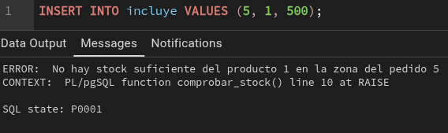

Stock después de insertar los datos de prueba, ya descontado:

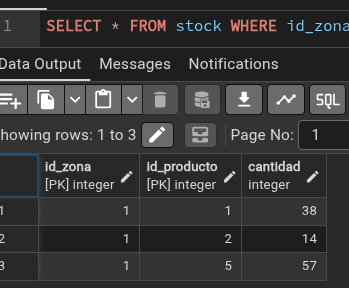

**Limitación de los dos triggers.** Solo se ejecutan al insertar (`BEFORE INSERT`). Si después se modificara un destino o la cantidad de una línea con `UPDATE`, no se volvería a comprobar. Para cubrirlo habría que añadir `BEFORE UPDATE`, teniendo en cuenta que la fila no debe compararse consigo misma y que en el stock solo habría que descontar la diferencia.

**Por qué no usamos `EXCLUDE`.** PostgreSQL tiene una restricción especial, `EXCLUDE`, que impide los solapamientos sin escribir un trigger, pero necesita la extensión `btree_gist`. Preferimos limitarnos a lo que incluye PostgreSQL sin extensiones.

## 3.5 Vistas

### Qué es una vista

Una vista es **una consulta guardada con nombre** que se usa como si fuera una tabla. No guarda datos: cada vez que se consulta, ejecuta su `SELECT` sobre las tablas reales, así que siempre está actualizada. Las usamos para los **atributos derivados**, que no se guardan porque se pueden calcular a partir de los pedidos.

| Elemento | Qué hace |
|---|---|
| `CREATE VIEW nombre AS SELECT ...` | Guarda la consulta con ese nombre. |
| `JOIN ... ON ...` | Une dos tablas por las columnas que coinciden (normalmente FK = PK). |
| `SUM(I.CANTIDAD * PR.PRECIO)` | Suma, línea a línea, unidades × precio: el importe total. |
| `COUNT(DISTINCT P.ID_PEDIDO)` | Cuenta pedidos sin repetir. El `DISTINCT` hace falta porque, al unir con INCLUYE, un pedido con tres productos aparece en tres filas. |
| `EXTRACT(YEAR FROM fecha)` / `EXTRACT(MONTH FROM fecha)` | Saca el año o el mes de una fecha, para agrupar por meses. |
| `GROUP BY` | Agrupa las filas: se obtiene una fila por cada grupo (por ejemplo, por cliente y mes). Toda columna del `SELECT` que no esté dentro de `SUM` o `COUNT` tiene que estar en el `GROUP BY`. |
| `AS nombre` | Pone un nombre a la columna calculada. |

### CLIENTES_PLUS

```sql
CREATE VIEW clientes_plus AS
SELECT id_cliente, nombre, fecha_ingreso
FROM cliente
WHERE fecha_ingreso IS NOT NULL;
```

Es el subtipo Plus de la jerarquía: los clientes que tienen fecha de ingreso en el programa. Se usa `IS NOT NULL` y no `<> NULL`, porque cualquier comparación con `NULL` usando `=` o `<>` no devuelve nunca filas.

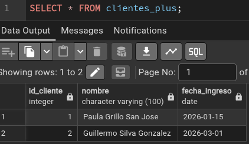

### BONIFICACIONES_PLUS

```sql
CREATE VIEW BONIFICACIONES_PLUS AS
SELECT C.ID_CLIENTE, C.NOMBRE,
       EXTRACT(YEAR FROM P.FECHA)  AS ANIO,
       EXTRACT(MONTH FROM P.FECHA) AS MES,
       SUM(I.CANTIDAD * PR.PRECIO)        AS VOLUMEN_COMPRAS,
       SUM(I.CANTIDAD * PR.PRECIO) * 0.05 AS BONIFICACION
FROM CLIENTES_PLUS C
JOIN PEDIDO P    ON P.ID_CLIENTE = C.ID_CLIENTE
JOIN INCLUYE I   ON I.ID_PEDIDO = P.ID_PEDIDO
JOIN PRODUCTO PR ON PR.ID_PRODUCTO = I.ID_PRODUCTO
WHERE P.FECHA >= C.FECHA_INGRESO
GROUP BY C.ID_CLIENTE, C.NOMBRE, EXTRACT(YEAR FROM P.FECHA), EXTRACT(MONTH FROM P.FECHA);
```

**Qué calcula.** Para cada cliente Plus y cada mes, su volumen de compras y la bonificación correspondiente.

**Cómo lo calcula:**

1. Parte de la vista `CLIENTES_PLUS`, así que solo tiene en cuenta clientes del programa.
2. Une cada cliente con sus pedidos (PEDIDO), cada pedido con sus líneas (INCLUYE) y cada línea con su producto (PRODUCTO), para conocer el precio.
3. `WHERE P.FECHA >= C.FECHA_INGRESO` descarta los pedidos anteriores al ingreso en el programa, porque el enunciado indica que los pedidos se controlan desde el ingreso.
4. `GROUP BY` cliente, año y mes: una fila por cada cliente y mes.
5. `VOLUMEN_COMPRAS` suma unidades × precio de todas las líneas de ese mes.
6. `BONIFICACION` es el 5 % de ese volumen (`* 0.05`). El enunciado no indica la regla, así que el 5 % es un supuesto nuestro; para cambiarlo basta con modificar ese número.

Ejemplo: en febrero, Paula compró 2 cactus polacos a 12,95 € y 3 enanos de jardín a 6,40 €: 2 × 12,95 + 3 × 6,40 = 45,10 €, y su bonificación es 45,10 × 0,05 = 2,255 €.

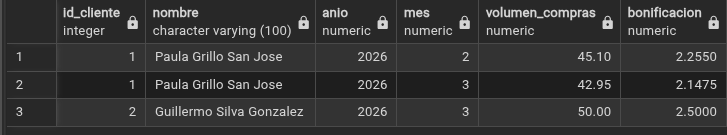

### PRODUCTIVIDAD_EMPLEADO

```sql
CREATE VIEW PRODUCTIVIDAD_EMPLEADO AS
SELECT E.ID_EMPLEADO, E.NOMBRE,
       EXTRACT(YEAR FROM P.FECHA)  AS ANIO,
       EXTRACT(MONTH FROM P.FECHA) AS MES,
       COUNT(DISTINCT P.ID_PEDIDO) AS NUM_PEDIDOS,
       SUM(I.CANTIDAD * PR.PRECIO) AS IMPORTE_VENTAS
FROM EMPLEADO E
JOIN PEDIDO P    ON P.ID_EMPLEADO = E.ID_EMPLEADO
JOIN INCLUYE I   ON I.ID_PEDIDO = P.ID_PEDIDO
JOIN PRODUCTO PR ON PR.ID_PRODUCTO = I.ID_PRODUCTO
GROUP BY E.ID_EMPLEADO, E.NOMBRE, EXTRACT(YEAR FROM P.FECHA), EXTRACT(MONTH FROM P.FECHA);
```

**Qué calcula.** La capacidad de cada empleado de lograr objetivos de venta: cuántos pedidos ha gestionado cada mes y por qué importe. Une cada empleado con los pedidos que gestiona (`P.ID_EMPLEADO = E.ID_EMPLEADO`) y suma el importe de sus líneas.

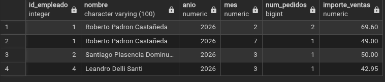

### PRODUCTIVIDAD_ZONA

```sql
CREATE VIEW PRODUCTIVIDAD_ZONA AS
SELECT Z.ID_ZONA, Z.ID_VIVERO,
       EXTRACT(YEAR FROM P.FECHA)  AS ANIO,
       EXTRACT(MONTH FROM P.FECHA) AS MES,
       COUNT(DISTINCT P.ID_PEDIDO) AS NUM_PEDIDOS,
       SUM(I.CANTIDAD * PR.PRECIO) AS IMPORTE_VENTAS
FROM ZONA Z
JOIN PEDIDO P    ON P.ID_ZONA = Z.ID_ZONA
JOIN INCLUYE I   ON I.ID_PEDIDO = P.ID_PEDIDO
JOIN PRODUCTO PR ON PR.ID_PRODUCTO = I.ID_PRODUCTO
GROUP BY Z.ID_ZONA, Z.ID_VIVERO, EXTRACT(YEAR FROM P.FECHA), EXTRACT(MONTH FROM P.FECHA);
```

**Qué calcula.** La productividad de cada zona a lo largo del tiempo: cuántos pedidos se han servido desde ella cada mes y por qué importe. Es igual que la anterior, pero agrupando por zona (`P.ID_ZONA = Z.ID_ZONA`). Combinándola con TAREA se puede saber qué empleados estaban en esa zona en cada periodo.

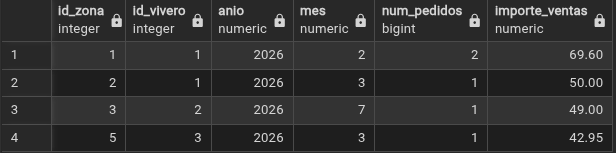

## 3.6 Comprobaciones

### Prueba de las restricciones

```sql
/* Tipo de producto no permitido: lo rechaza el CHECK */
INSERT INTO PRODUCTO (NOMBRE, TIPO, PRECIO) VALUES ('Abono', 'fertilizante', 5);

/* Precio negativo: lo rechaza el CHECK */
INSERT INTO PRODUCTO (NOMBRE, TIPO, PRECIO) VALUES ('Abono', 'jardineria', -5);

/* Destino que termina antes de empezar: lo rechaza el CHECK de TAREA */
INSERT INTO TAREA VALUES (3, 4, '2026-10-01', '2026-09-01', 'riego');

/* Borrar una zona con pedidos: lo impide la clave foránea de PEDIDO */
DELETE FROM ZONA WHERE ID_ZONA = 1;
```

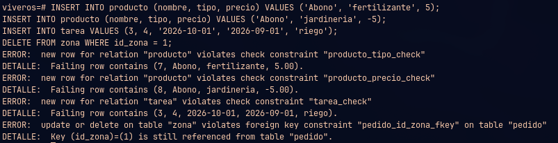

---

# 4. Modelo relacional


Generado con pgAdmin: base de datos `viveros` → menú **Object** → **ERD For Database**.

---

# 5. Resumen de restricciones

| Restricción | Implementación | Por qué así |
|---|---|---|
| Identificadores únicos y obligatorios | `PRIMARY KEY` | |
| Relaciones entre tablas | `REFERENCES` (FK) | |
| Campos obligatorios | `NOT NULL` | |
| Coordenadas válidas | `CHECK (... BETWEEN ...)` | Solo mira la propia fila |
| Tipo de producto válido | `CHECK (TIPO IN (...))` | Solo mira la propia fila |
| Precios positivos y cantidades no negativas | `CHECK` | Solo mira la propia fila |
| Fecha de fin no anterior a la de inicio | `CHECK` en TAREA | Solo mira la propia fila |
| Un empleado no tiene dos destinos a la vez | Trigger `trg_comprobar_destinos` | Hay que comparar con las otras filas |
| Un pedido no supera el stock de su zona | Trigger `trg_comprobar_stock` | Hay que consultar otras tablas |
| Bonificaciones solo desde el ingreso | `WHERE` en la vista `BONIFICACIONES_PLUS` | No limita qué se guarda, solo qué se cuenta |
| Regla de bonificación fija (5 %) | Supuesto del diseño | No se comprueba |
| No perder el histórico de ventas | FK sin `ON DELETE CASCADE` en PEDIDO y INCLUYE | |

**Pedidos anteriores al ingreso.** No se impide guardar pedidos de un cliente anteriores a su ingreso en el programa, porque pudo comprar antes de ser Plus y esas ventas cuentan para el stock y la productividad. Lo que se limita es qué pedidos cuentan para las bonificaciones.

**Lo que no se puede forzar.** Algunos mínimos del E/R no se pueden garantizar con claves foráneas, porque una FK obliga a que el hijo tenga padre, pero no a que el padre tenga hijos:

- Un vivero tiene al menos una zona.
- Un pedido incluye al menos un producto.
- Un producto está en al menos una zona, y una zona contiene al menos un producto.

Se podrían controlar con triggers, pero complicarían la inserción de datos (por ejemplo, no se podría crear un vivero sin crear a la vez su primera zona). Por eso los dejamos como restricciones semánticas documentadas.
